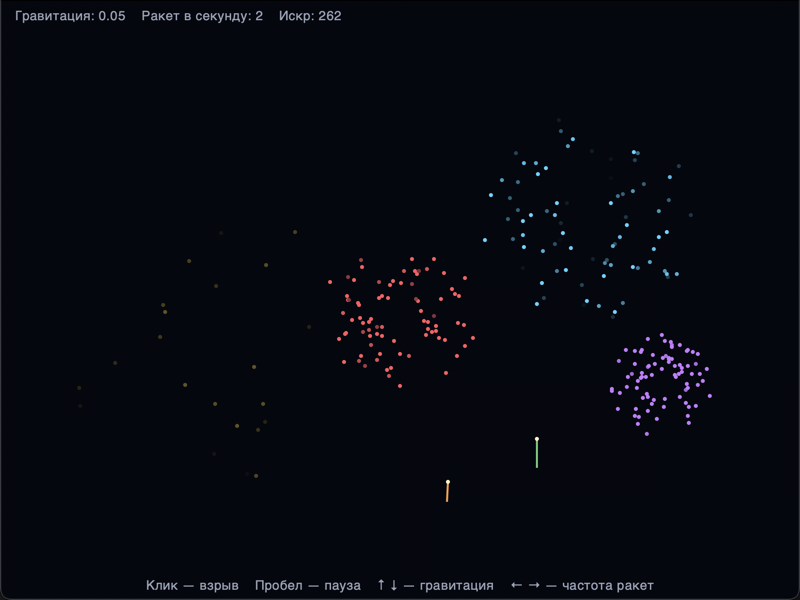

# Фейерверки — анимация частиц

**Автор:** Рошинец Владислав Маратович  
**Группа:** ПИ25-1  
**Дисциплина:** Практикум по программированию

## Описание проекта

Анимация фейерверков на `tkinter`. Снизу экрана взлетают ракеты, в самой высокой
точке они взрываются и разлетаются на искры разных цветов. Искры падают под
действием гравитации, постепенно гаснут и исчезают.

## Демонстрация работы программы



## Функциональные возможности

### Основной функционал
- 🚀 Ракеты сами взлетают снизу экрана в случайных местах и с разной скоростью
- 💥 В самой высокой точке ракета взрывается и разлетается на 80 искр во все стороны
- ⏳ У фейерверка и его искр ограниченное время жизни: ракета живёт до взрыва,
  искра — от 40 до 80 кадров, потом исчезает
- 🌍 Искры падают под действием гравитации и тормозят в воздухе
- 🖱️ Клик мышью — взрыв фейерверка в точке клика
- ⏸️ Пауза

### Дополнительный функционал
- 🎨 Фейерверки разных цветов: у каждого взрыва случайный цвет из восьми
- 🌫️ Прозрачность: перед смертью искра плавно гаснет и растворяется в небе
- 🪐 Эксперименты с гравитацией: клавишами ↑ / ↓ гравитацию искр можно менять
  от 0 (искры летят по прямой) до 0.3 (искры сразу падают вниз)
- 🎚️ Частота запуска ракет: клавишами ← / → от 0 до 10 ракет в секунду
- ✅ Модульные тесты для частиц и логики фейерверков

## Требования к системе

- **Python:** 3.9 или выше
- **Операционная система:** Windows / macOS / Linux
- **Библиотеки:** только стандартные: `tkinter` (встроенная), `math`, `random`, `unittest`

## Установка и запуск

### 1. Клонирование репозитория
```bash
git clone https://github.com/brrmaleey/fireworks.git
cd fireworks
```

### 2. Создание и активация виртуального окружения
Папка `venv/` уже лежит в репозитории (так требуется для проверки).
Если она не запускается на вашем компьютере, создайте её заново.

Windows:
```bash
python -m venv venv
venv\Scripts\activate
```
macOS/Linux:
```bash
python3 -m venv venv
source venv/bin/activate
```

### 3. Установка зависимостей
```bash
pip install -r requirements.txt
```
Сторонних библиотек нет, команда ничего не установит.

### 4. Запуск программы
```bash
python main.py
```

### 5. Управление
| Клавиша | Действие |
|---|---|
| **Клик мышью** | взрыв в точке клика |
| **Пробел** | пауза / продолжить |
| **↑ / ↓** | сильнее / слабее гравитация искр |
| **→ / ←** | чаще / реже запускать ракеты |

### 6. Запуск тестов
```bash
python -m unittest -v
```

## Структура проекта

```
fireworks/
├── .gitignore
├── README.md
├── requirements.txt
├── main.py
├── venv/
├── screenshots/
│   └── fireworks.png
├── src/
│   ├── __init__.py
│   ├── app.py
│   ├── models/
│   │   ├── __init__.py
│   │   ├── particles.py
│   │   └── fireworks_model.py
│   └── renderers/
│       ├── __init__.py
│       └── renderer.py
└── tests/
    ├── __init__.py
    └── test_model.py
```

**Назначение основных модулей:**
- `main.py` — точка входа в программу
- `app.py` — класс `App`: окно, холст, клавиатура, мышь и цикл анимации
- `particles.py` — классы частиц: общий `Particle` и наследники `Rocket` (ракета) и `Spark` (искра)
- `fireworks_model.py` — класс `FireworksModel`: запуск ракет, взрывы, движение
  искр, гравитация и пауза
- `renderer.py` — класс `Renderer`: рисует ракеты, искры и надписи; функция
  `blend()` смешивает цвета для угасания искр
- `test_model.py` — тесты для частиц, модели и смешивания цветов

Логика (модель) отделена от отрисовки, поэтому её можно тестировать без окна.
Частицы вынесены в отдельный модуль: ракета и искра — это одна и та же точка
со скоростью, поэтому общее движение описано один раз в `Particle`, а наследники
добавляют только своё (ракета умеет понять, что долетела, искра — что погасла).
Папки `widgets/` из примерной структуры нет: слайдеров и кнопок нет, управление
идёт с клавиатуры и мыши.

## Как это работает

1. `App.update()` вызывается каждые 16 мс (около 60 кадров в секунду) через `window.after()`.
2. `FireworksModel.step()` за один кадр:
   - с вероятностью `частота / 60` запускает новую ракету (при частоте 2 это
     в среднем 2 ракеты в секунду);
   - двигает ракеты. Ракета, которая перестала подниматься (`dy >= 0`), взрывается;
   - двигает искры и убирает из списков взорвавшиеся ракеты и погасшие искры.
3. Движение любой частицы (`Particle.move()`): к скорости вниз `dy` прибавляется
   гравитация, потом к координатам прибавляется скорость. Ось y на экране смотрит
   вниз, поэтому летящая вверх ракета тормозит, останавливается в верхней точке,
   и как раз в этот момент взрывается.
4. Взрыв (`FireworksModel.explode()`): каждая из 80 искр получает случайный угол
   и скорость. `cos(угол) * скорость` даёт скорость по x, `sin(угол) * скорость`
   — по y, поэтому искры разлетаются кругом.
5. Искра каждый кадр теряет 2 % скорости (сопротивление воздуха) и одну единицу
   жизни. Когда жизнь кончается, искра удаляется.
6. В `tkinter` нет прозрачности, поэтому угасание сделано смешиванием цветов:
   за последние 30 кадров жизни цвет искры функцией `blend()` плавно переходит
   в цвет фона, и искра будто растворяется.
7. `Renderer.draw()` очищает холст и рисует ракеты с хвостами, искры и надписи.

## Пример использования

1. Запустите `python main.py` — ракеты начнут взлетать и взрываться сами.
2. Кликните мышью в любом месте неба — там взорвётся фейерверк случайного цвета.
3. Нажмите **↑** несколько раз — искры станут тяжелее и будут сразу падать вниз.
   Нажмите **↓** до нуля — искры полетят по прямой во все стороны.
4. Нажмите **→**, чтобы запускать больше ракет, или **←** до нуля, чтобы
   взрывать фейерверки только кликами.
5. Нажмите **пробел**, чтобы остановить кадр и рассмотреть взрыв.
